Базовая часть

1. Платформа одной командой
Вывод kubectl get pods -A:
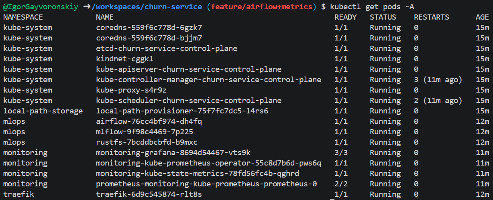
Подъём проекта с нуля занял около 7 минут с учётом запуска workflow.

2. Метрики и дашборд
Скрин дашборда под трафиком:
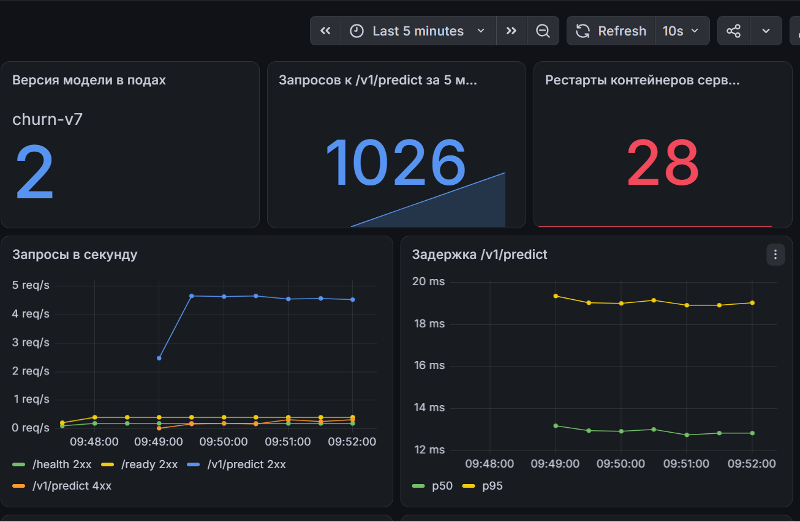
.png>)
.png>)

3. Данные в DVC и S3 кластера
Скрин бакета в консоли S3:
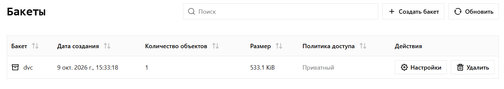
Вывод docker run --rm <образ> ls <папка с данными>:
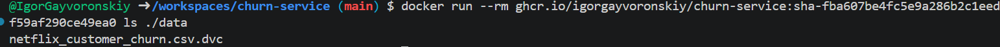

4. Проверка данных
Зелёный прогон CI с этими тестами: https://github.com/IgorGayvoronskiy/churn-service/actions/runs/38907093057
Прогон validate в MLflow с valid=false:
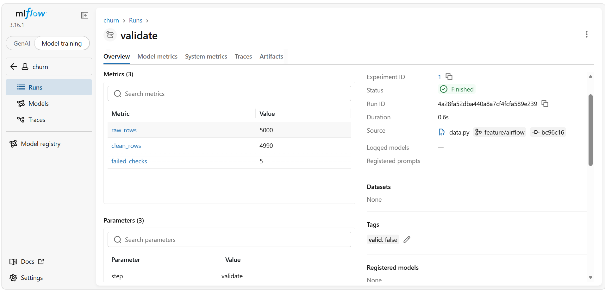
Открытый failure_cases.csv:
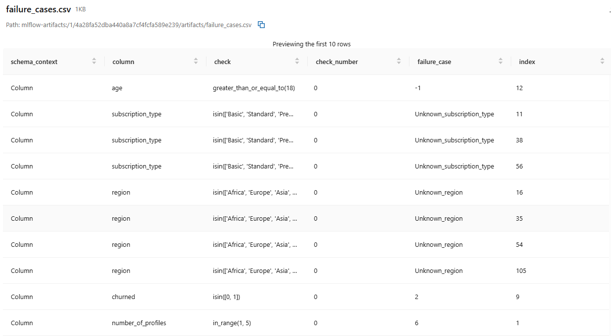
Для распределения таргета порог подбирался по среднему, а для параметра avg_watch_time_per_day по медиане распределения в исходных данных. Диапазон был чуть расширен в обе стороны, чтобы порог не был слишком строгим.

5. Конвейер переобучения в Airflow
- Новая версия лучше
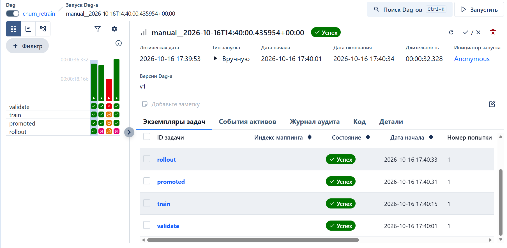
- Гейт не пустил
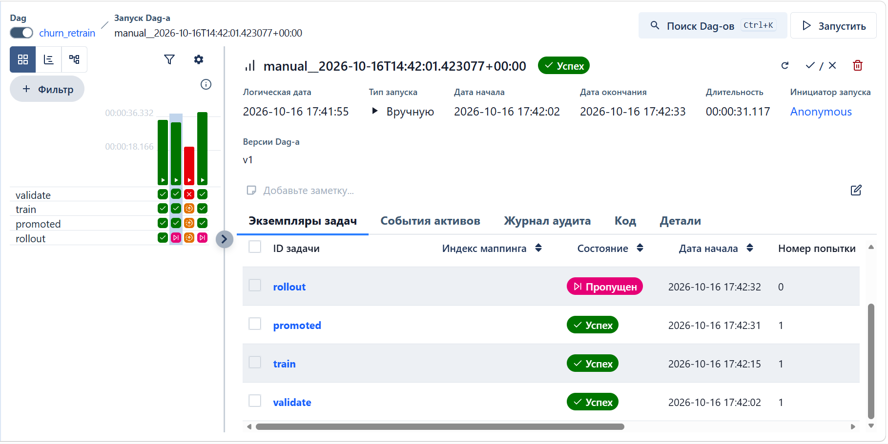
- Плохая выгрузка
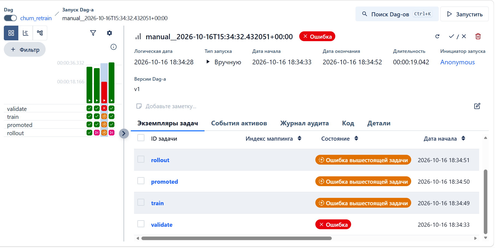
- После отката
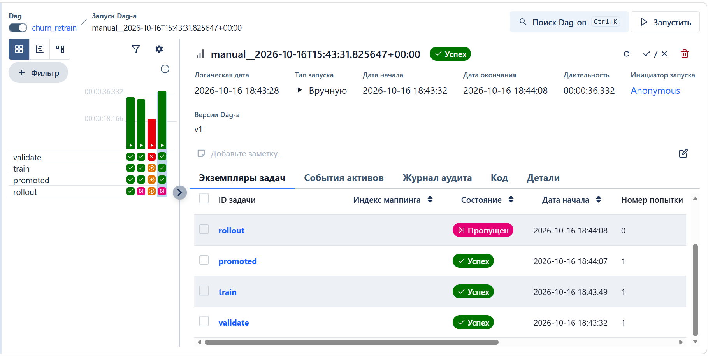
Model registry с колонкой Aliases
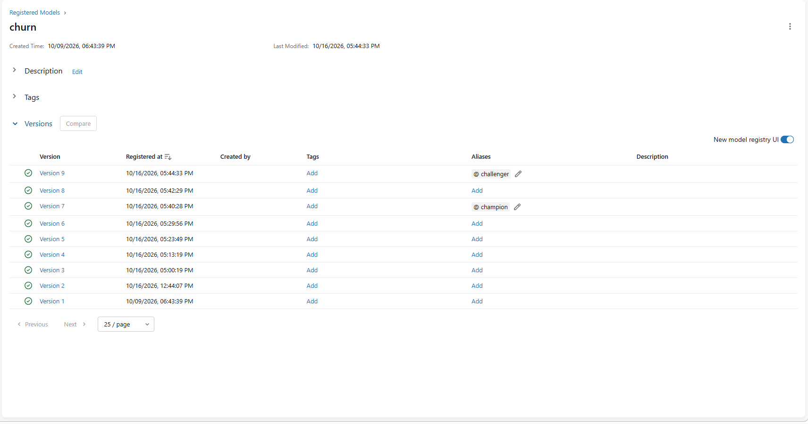
Скрин дашборда с переключением версии
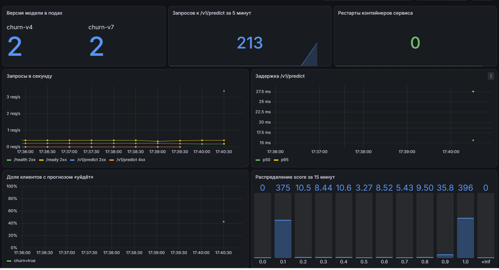
Вывод генератора трафика за время выката
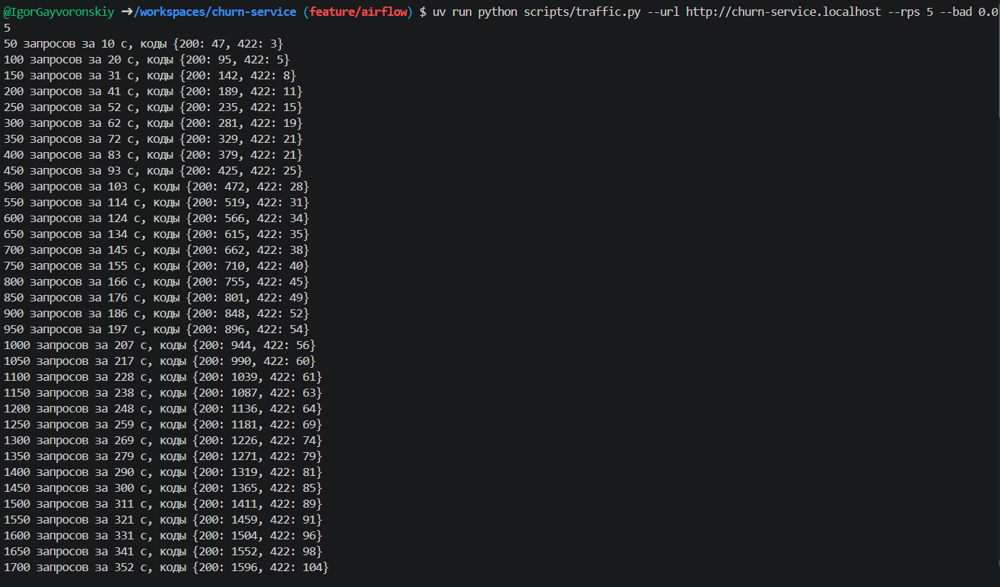

6. CI/CD целиком
Ссылка на зелёный прогон: https://github.com/IgorGayvoronskiy/churn-service/actions/runs/38925868193
---
Ответы на вопросы
1. Найти модель в MLflow. По имени и версии модели открыть соответствующий запуск (Run ID) и записать параметры и метаданные: data_md5, data, версию модели, параметры обучения и ссылку на артефакт модели. Далее по md5 хэшу найти соответствующий коммит и, выполнив git checkout, восстановить код. Далее через uv run dvc checkout восстановить нужную версию файла, указанного в параметре data. 
2. Данные не хранятся в образе, чтобы не перегружать его. Также наличие указателей позволяет осуществлять версионирование данных. Если сделать dvc push до git push, то в проде появится указатель на данные, которых нет в хранилище и dvc pull в поде упадёт. Ошибку можно будет увидеть при выполнении churn_retrain на шаге validate.
3. В моей схеме есть проверки на конкретные значения: например, churned может быть только 0 или 1, customer_id должен быть уникальным, а категории - из заданного списка. Есть и проверки с порогами: минимум 1000 строк, доля оттока от 40% до 60% и медиана давности последнего входа от 20 до 40 дней.
Пороги я выбирал по распределению исходных данных, чтобы выявлять аномалии. Если порог окажется слишком строгим, корректные данные могут не пройти проверку.
4. Pandera схема проверяет корректность данных перед обучением, в то время как pydantic схема нужна для проверки корректности данных в запросе сервиса.
5. Обучение выполняется в отдельном поде из образа сервиса, так как Airflow выполняет только роль оркестратора, а само обучение должно выполняться на том же коде, что хранится в образе churn-service. Выкат новой модели не требует пересборки образа, потому что в данном случае необходимо подгрузить из MLflow новую версию модели, а для этого нужно лишь перезапустить соответствующие поды с сервисом.
6. 
Инфраструктурные метрики: "Рестарты контейнеров сервиса";
Метрики сервиса: "Запросов к /v1/predict за 5 минут", "Запросы в секунду", "Задержка /v1/predict";
Метрики модели: "Доля клиентов с прогнозом «уйдёт»", "Распределение score за 15 минут", и метрики распределения числовых признаков.
request_id нельзя добавлять в метки Prometheus, потому что каждый запрос имеет уникальный идентификатор. Это создаст огромное потребление памяти и нагрузку на Prometheus.
7. Во время выката новой модели новые поды поднимаются и проходят проверку готовности, затем на них переключается трафик, а старые завершаются после обработки текущих запросов. PreStop же помогает безопасно вывести старый под из обслуживания без потери запросов.
8. Вероятнее всего модель начнёт постепенно деградировать из-за дрейфа данных. Через некоторое время это станет заметно в мониторинге, например рост PSI по признакам или сдвиг в распределении скоров предсказаний модели. Однако подтвердить деградацию качества можно будет только после прихода фактических меток и расчёта метрик. Первым делом следует проверить, что изменение случилось не из-за ошибки в данных или пайплайне. Следующим шагом будет проверка масштабов дрейфа и, если метрики подтвердят деградацию модели, запуск переобучения на новых данных.